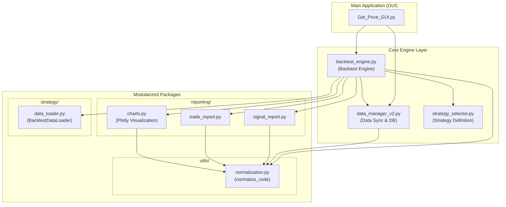

# Architecture Overview - Modularized Backtest Engine

This document provides a high-level overview of the modularized architecture of the backtesting system.

## 1. System Diagram

## 2. Component Descriptions

### Main Application (GUI)
- **Get_Price_GUI.py**: The entry point of the application. Handles user input, parameter loading, and triggers both data synchronization and backtesting.

### Core Engine Layer
- **backtest_engine.py**: The central logic for the backtest. Manages the simulation loop, parameter optimization, and multi-threaded execution.
- **data_manager_v2.py**: Manages database connections, data harvesting (Kiwoom API), and caching.
- **strategy_selector.py**: Contains strategy metadata, default parameters, and the `TradingStrategy` class for signal calculation logic.

### Modularized Packages
- **reporting/**: Handles all output generation. Segregated from the engine to allow for independent updates to visualization and reporting styles.
- **strategy/**: Houses reusable strategy components. `BacktestDataLoader` encapsulates the complexity of fetching and merging 15-minute and 1-minute data.
- **utils/**: Project-wide utility functions. `normalization.py` ensures all stock codes are formatted consistently throughout the app.
