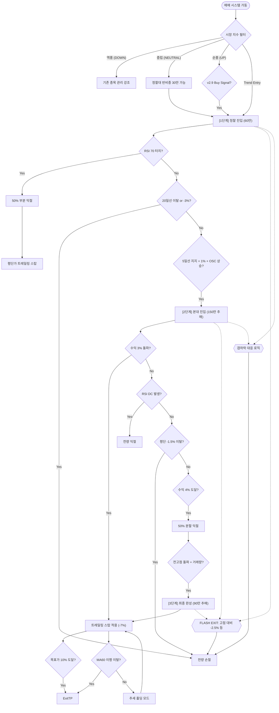

# 📉 v3.0 스윙 매매 통합 시나리오 (정밀 백테스팅용)

본 문서는 `v2.9`를 넘어선 더욱 정교한 자금 운용과 시장 대응 로직을 담고 있습니다. 시장의 흐름(지수)을 최우선으로 하며, 수익의 확정적 분리와 리스크 관리를 통해 안정적인 누적 수익을 목표로 합니다.

---

## 0. 매매 전략 프로세스 맵 (Flowchart)

---

## 1. 전제 조건 및 자금 운용

- **기본 시드**: 1,000만 원 (종목당 최대 300만 원 할당)
- **수익금 관리**: 매매 종료 시 발생하는 수익은 원금과 별도로 합산.
- **슬롯 확대**: 누적 수익금이 **300만 원**이 될 때마다 운영 종목 수를 **+1개** 늘림.
- **시장 지수 필터 (KOSPI/KOSDAQ)**:
  - **순풍(UP)**: 지수가 5일 이평선 위 + 5일선 기울기 양수(+) → **적극 매수/추매**
  - **중립(NEUTRAL)**: 지수가 5일선 근처에서 횡보하며 기울기가 평탄함 → **제한적 진입/관망**
  - **역풍(DOWN)**: 위 조건 미충족 → **신규 매수 금지**, 기존 보유 종목 관리(익절/손절) 집중

---

## 2. 단계별 매매 프로세스

### [1단계] 정찰 진입 (Scout Entry)
- **비중**: 60만 원 (전체 한도의 20%)
- **진입 조건 (Dual Mode)**:
  - **Type A (눌림목)**: 지수 '순풍/중립' + v2.9 buy_signal (RSI 35~50 등).
  - **Type B (추세돌파)**: 지수 '순풍' + 20/60일선 정배열 + MACD GC + 거래량 증가.
- **방어 (손절)**: 15분봉 종가 기준 20일 이평선 이탈 또는 매수가 대비 **-3%** 도달 시 즉시 전량 매도.
- **공격 (익절)**: 2차 매수 전이라도 **RSI(14)가 70을 터치**하면 단기 과열로 판단하여 **보유 물량의 50% 익절**. 남은 물량은 평단가 본절가 스탑 적용.

### [2단계] 추세 확정 및 비중 확대 (Confirmation)
- **비중**: 150만 원 추가 (총 210만 원)
- **진입 조건**: 지수 '순풍' 유지 + 15분봉상 캔들의 저가가 **5일선 위**에서 형성(지지 확인) + 1차 매수가 대비 **+1% 수익권** + **MACD 오실리에이터 상승 중**.
- **방어 (손절)**: 평균 단가 대비 **-1.5%** 이탈 시 즉시 전량 매도 (v3.6 본절가 사수 완화).
- **공격 (익절)**: 평단가 대비 **+4% 수익** 도달 시 보유 물량의 **50%를 매도**하여 확정 수익금 적립.
- **특이사항 (Big Win)**: 수익률이 **3%를 초과**하거나 50% 분할 익절이 완료된 상태에서는 RSI DC 신호가 발생하더라도 **전량 매도하지 않고** 추세 홀딩 모드로 전환합니다.

### [3단계] 전고점 돌파 및 최종 비중 (Final Punch)
- **비중**: 90만 원 추가 (총 약 300만 원 완성)
- **진입 조건**: 2단계 부분 익절 완료 후 + **당일 고점 돌파** + 1분 거래량 **300% 이상 급증** + MACD 오실리에이터 확장.
- **상충 해결 방어**: 
  - 3차 매수 직후 15분간은 **'3차 매수 당시 양봉의 시가'**를 손절선으로 설정. 
  - 이후 안정화되면 **'본절가 -2.0%'**를 마지노선으로 설정 (v4.0 여유 확대).
- **최종 익절 (Mega Trend Exit)**: 
  - **무제한 홀딩**: 3단계 물량은 고정 익절가 없이 추세가 끝날 때까지 보유합니다.
  - **트레일링 스탑**: 고점 대비 **-7%** 이탈 시에만 매도 (v4.0 깊은 조정 허용).
  - **최종 생명선**: 15분봉 종가 기준 **60일 이평선(MA60)**을 하향 돌파할 때 전량 매도.

---

## 3. 상황별 예외 대응 (Exception Handling)

| 상황 판단 기준 | 대응 행동 |
| :--- | :--- |
| **지수 급락** (실시간 5일선 이탈) | 모든 단계에서 즉시 익절/손절 준비 (보수적 대응) |
| **돌파 실패** (3차 매수 후 15분 이내 시가 이탈) | '가짜 돌파'로 간주, 2차 수익금 보호를 위해 즉시 탈출 |
| **신호 상충** (종목 '매수'이나 지수 '역풍') | **지수 우선**. 매수 버튼에 손대지 않음 |

### 특수 상황: 갭하락 대응 (Gap Down Handling)

스윙 매매의 최대 리스크인 갭하락 발생 시, 지수 상태에 따라 기계적으로 대응합니다.

1. **지수 역풍 + 종목 갭하락**: 장 시작과 동시에 **시가에 즉시 전량 탈출**.
2. **지수 순풍 + 종목 갭하락**: 장 시작 후 **15분 대기**. 15분봉 시가를 회복하지 못하거나, 15분봉 저가 이탈 시 즉시 매도.
3. **공통 마지노선**: 갭하락으로 인해 실시간 손실이 **-5%를 초과**하면 이유 불문 즉시 매수 정지 및 전량 매도.

### 지수 필터 예외: 횡보/모호한 구간 (Neutral/Chop Market)

지수가 5일선 근처에서 횡보하며 방향성이 불분명한 경우 다음의 규칙을 적용합니다.

1. **신규 1단계(정찰대)만 가능**: 단, 종목의 `buy_signal`이 매우 강력할 때만 **1/2 비중(30만 원)**으로 진입을 제한합니다.
2. **비중 확대 금지**: 지표가 확실한 '순풍'으로 전환되기 전까지는 절대 2단계 본대 진입을 금지합니다.
3. **기존 종목 보호**: 보유 종목의 익절가/손절가를 현재가 근처로 바짝 붙여(Trailing Stop 강화) 지수 급락 리스크에 대비합니다.

### FLASH EXIT: 지표보다 빠른 탈출 (Leading Safeguards)

보조지표의 후행성으로 인한 대항 하락을 방지하기 위해 가격과 체결 흐름을 우선합니다.

1. **고점 사수**: 매수 후 발생한 당일 최고가 대비 **-3.0%** (v3.5 완화) 이탈 시 MACD/RSI 상태와 상관없이 전량 매도.
2. **캔들 보호**: 3단계 진입 후에는 **'현재 진행 중인 15분봉의 저가'**가 이전 봉의 저가보다 낮아지면 추세 훼손으로 간주하여 매도 준비.
3. **체결 변화**: 가격은 버티더라도 **체결강도(Power)가 80**을 하회하면 추세 생명력이 다한 것으로 판단하여 즉시 탈출.

---

## 4. 시나리오의 핵심 철학 (The Logic)

1. **지수 우선 원칙**: 시장이 무너지면 어떤 우량주도 버티기 힘들다는 백테스팅 결과를 철저히 반영합니다.
2. **본절가 사수**: 2단계부터는 투입 금액이 커지므로, 평단가를 위협하면 시장이 '아직 갈 때가 아니다'라고 말하는 것으로 해석합니다.
3. **수익의 확정적 분리**: 2단계 50% 익절을 통해 심리적 안정감을 확보하고, 3차 매수를 '보너스 게임'처럼 운영하여 수익률을 극대화합니다.

> [!IMPORTANT]
> **심리적 우위**: 이 시나리오는 "무조건 수익"이 아니라 "안전한 누적"을 목표로 합니다. 원칙을 지키는 매매가 가장 큰 수익을 가져다줍니다.
- [v3.4] RSI 지표 계산 방식을 Wilder's Smoothing(EMA 기반)으로 변경하여 아침 갭상승/급등락 시의 일시적 노이즈를 억제함.
